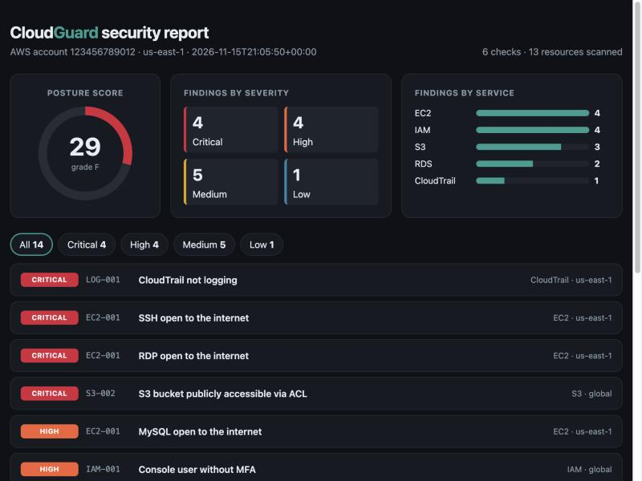
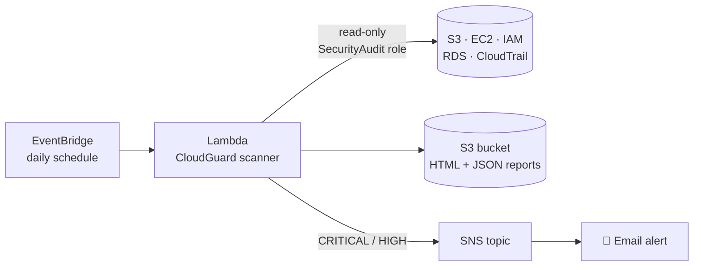

# CloudGuard ☁️🛡️

**A lightweight AWS security posture scanner.** CloudGuard audits an AWS account for the misconfigurations behind real-world cloud breaches (public S3 buckets, SSH/RDP open to the internet, users without MFA, missing audit logs), scores the account 0–100, and produces an interactive HTML report with a fix command for every finding.

It runs three ways:
- **On your laptop** as a CLI
- **In a CI/CD pipeline** as a security gate (`--fail-on HIGH`)
- **In AWS as a serverless daily scanner** deployed with Terraform (Lambda + EventBridge + S3 + SNS email alerts)



---

## Why I built this

In IT support I spend my days fixing problems after they happen. I wanted to build something that **catches problems before they become incidents**. Most cloud breaches come from simple misconfigurations, not sophisticated hacks: a bucket left public, port 22 open to the world, an admin with no MFA. CloudGuard automates the checklist a cloud or security engineer would otherwise run by hand.

## What it checks

| ID | Check | Severity | CIS AWS Benchmark |
|---|---|---|---|
| S3-001 | S3 Block Public Access not fully enabled | High | 2.1.4 |
| S3-002 | S3 bucket public via ACL | Critical | 2.1.4 |
| S3-003 | S3 versioning disabled | Low | – |
| EC2-001 | SSH / RDP / all traffic open to 0.0.0.0/0 | Critical | 5.2 |
| EC2-001 | Database ports (MySQL, Postgres, MSSQL, MongoDB) open to internet | High | – |
| EC2-002 | EBS encryption-by-default disabled | Medium | 2.2.1 |
| IAM-001 | Console user without MFA | High | 1.10 |
| IAM-002 | Access key older than 90 days | Medium | 1.14 |
| IAM-003 | AdministratorAccess attached directly to a user | Medium | 1.15 |
| IAM-004 | Weak / missing password policy | Medium | 1.8 |
| LOG-001 | CloudTrail not logging | Critical | 3.1 |
| RDS-001 | RDS instance publicly accessible | High | 2.3.3 |
| RDS-002 | RDS storage not encrypted | Medium | 2.3.1 |

Every finding includes **why it matters** in plain English and a **copy-paste remediation** (usually an AWS CLI command).

## Architecture



Design decisions:
- **Least privilege.** The Lambda uses AWS's managed read-only `SecurityAudit` policy plus write access to only its own report bucket and alert topic.
- **The tool practices what it preaches.** The report bucket is private, encrypted, versioned, and expires old reports automatically.
- **Pluggable checks.** Each check is one Python function with an `@check` decorator, so adding a new rule means writing one function.
- **Parallel and multi-region.** Regional checks run concurrently in a thread pool. Global services (IAM, S3) run once.

## Quick start

```bash
git clone https://github.com/eduardosanmelen-jpg/cloudguard.git
cd cloudguard
python3 -m venv .venv && source .venv/bin/activate
pip install -r requirements-dev.txt
```

**Try it with no AWS account.** Demo mode builds a deliberately vulnerable account inside [moto](https://github.com/getmoto/moto) (an in-memory AWS simulator) and scans it with the real checks:

```bash
python -m cloudguard --demo --html report.html
open report.html
```

**Scan your own AWS account** (uses your AWS CLI credentials, read-only):

```bash
python -m cloudguard --profile default --regions us-east-1,us-west-2 --html report.html --json report.json
```

**Use as a CI security gate.** Exits with code 1 if anything is HIGH or worse:

```bash
python -m cloudguard --fail-on HIGH
```

## Deploy to AWS (Terraform)

```bash
cd terraform
terraform init
terraform apply -var="alert_email=you@example.com"
# then confirm the SNS subscription email, and trigger a scan right away:
aws lambda invoke --function-name cloudguard out.json && cat out.json
```

The daily reports go to `s3://cloudguard-reports-<account-id>/reports/`. Everything here fits within the AWS Free Tier for a personal account. Run `terraform destroy` to remove it all.

## Testing & CI

- **10 unit tests** run against moto's mocked AWS, so no cloud costs and no credentials are needed: `pytest -q`
- **GitHub Actions** runs lint (ruff), tests on Python 3.10/3.12/3.13, a demo scan (the report is uploaded as a build artifact), and `terraform fmt` + `terraform validate`.

## Project layout

```
cloudguard/
  checks.py          # all security checks (@check registry)
  scanner.py         # runs checks across regions in parallel
  models.py          # Finding / ScanResult, scoring
  report.py          # console, JSON, and HTML dashboard output
  cli.py             # command-line interface
  lambda_handler.py  # AWS Lambda entry point
  demo.py            # simulated vulnerable account for demos
terraform/           # Lambda + EventBridge + S3 + SNS + IAM
tests/               # pytest + moto
.github/workflows/   # CI pipeline
```

## Roadmap

- [ ] More checks: GuardDuty enabled, root account MFA, KMS key rotation, Lambda public URLs
- [ ] Slack / Microsoft Teams alerts
- [ ] Score trend over time (compare against the previous report in S3)
- [ ] Multi-account scanning via AWS Organizations
- [ ] Azure support

## Skills demonstrated

`AWS (S3, EC2, IAM, RDS, CloudTrail, Lambda, EventBridge, SNS)` · `Python` · `boto3` · `Terraform / IaC` · `CI/CD (GitHub Actions)` · `Cloud security` · `CIS Benchmarks` · `Least-privilege IAM` · `Unit testing with mocks`
